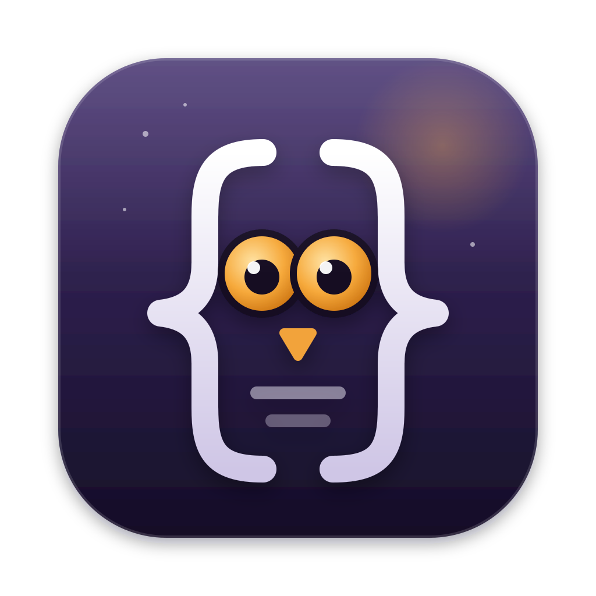

<p align="center"></p>

# Sarkhan’s Claude Starter

Rules Claude Code can't skip, a team of specialist agents, and a report on every change — for projects in any language, with extra support for TypeScript/Next.js, Go, PHP (Laravel/Symfony), Python (Django/FastAPI), Rust, Java/Kotlin, .NET, Ruby, Dart/Flutter, Swift and Docker.

Project site: **https://rasimoghlu.github.io/sarkhans-claude-starter/**

## Get it

### Option 1: Claude Code plugin (Windows, Linux, macOS)
Run these two commands in a terminal, then start Claude Code:
```bash
claude plugin marketplace add Rasimoghlu/sarkhans-claude-starter
claude plugin install sarkhans-starter@sarkhans-claude-starter
```
The rules, agents, skills and guardrails then work in every project. Skills are named like `/sarkhans-starter:verify`. [More about the plugin](#claude-code-plugin-windows-linux-macos)

### Option 2: Mac app
### [Download Sarkhan’s Claude Starter for Mac](https://github.com/Rasimoghlu/sarkhans-claude-starter/releases/latest/download/Sarkhans-Claude-Starter.dmg)
macOS 13 or newer, Apple Silicon and Intel, always the latest version. [How to install](#install-on-a-mac).

The app adds what the plugin can't: one-click setup for all your projects with the right rules for each stack, a work mode per project, team rules you pick with a click, a weekly report of what the guardrails stopped, and automatic updates.

## What's inside
- **Guardrails that block**, not just instructions: hooks stop comments in code, invented imports, pushes to main, AI mentions in commits, secret files and unsafe code.
- **Work modes** per project (Lite / Standard / Strict) and a team of specialist agents for bigger work, with reviewers that keep project memory.
- **Guardrail report**: the app shows what the rules stopped this week in each project.
- **Security testing**: `/security-audit` reads the code for holes, `/pentest` attacks your running app on localhost or a staging server you name, proves each hole with a real request and turns it into a regression test. A hook keeps security tools away from every other host. For pull requests there's a ready [GitHub workflow](examples/github) with Anthropic's security review.
- **Modern web know-how**: Google Chrome's [Modern Web Guidance](https://github.com/GoogleChrome/modern-web-guidance) comes with every web project and with the plugin, so Claude looks up current HTML, CSS, accessibility, performance and security practice before writing UI code.
- **Team rules**: share your team's conventions from one folder; choose a default team, or a different team per project. Works in the app and in the plugin.
- Third-eye reports, design lock, database review, kickoff for new projects, and about 2,800 tokens of rules per session.

- What it does and how it works: [`claude-web-starter/README.md`](claude-web-starter/README.md)
- Internals, CLI contract, Windows porting notes: [`docs/ARCHITECTURE.md`](docs/ARCHITECTURE.md)

## Requirements
- To use: macOS 13+ and Claude Code with a Claude Pro, Max, Team or Enterprise plan (the free plan doesn't include Claude Code). Claude Code, Node.js and Git can be installed from inside the app.
- To build the app: Xcode Command Line Tools (`xcode-select --install`).

## Install on a Mac

### 1. Put the app in Applications
Open the downloaded `Sarkhans-Claude-Starter.dmg` and drag **Sarkhan’s Claude Starter** onto the **Applications** folder.
If your Mac account has no admin rights, drag it into the **Applications** folder inside your home folder instead (Finder → Go → Home; create a folder named `Applications` if it isn't there).

### 2. Allow it once
The app isn't notarized by Apple (that needs a paid Apple developer account). That's why macOS asks you to confirm it **once**, the first time you open it. Apps from developers who pay Apple for notarization show a simple **Open** button instead.

**macOS 15 Sequoia, macOS 26 Tahoe and macOS 27 Golden Gate (the current version)**
1. Double-click **Sarkhan’s Claude Starter** in Applications. macOS says the app was not opened. Click **Done**, not Move to Trash.
2. Open the **Apple menu** → **System Settings** → **Privacy & Security**.
3. Scroll all the way down to **Security**. Next to the message that the app was blocked to protect your Mac, click **Open Anyway**.
4. In the next window click **Open Anyway** again and confirm with your password or Touch ID. The app opens.

The **Open Anyway** button appears only after step 1 and stays for about an hour. If you don't see it, do step 1 again.

**macOS 13 Ventura and macOS 14 Sonoma**
Right-click (or Control-click) the app in Applications → **Open** → **Open**.

After this, the app opens normally with a double-click. Updates install themselves from inside the app and don't ask again.

### 3. Set it up
The app opens a short setup screen:
- **Node.js**, **Git** and **Claude Code**: press the button if one is missing and finish the installer.
- **Projects folder**: choose the folder with your projects.
- **Claude's language**: the language Claude explains things in.

Then select your projects and press **Set up**. **Open in Claude Code** in a project's panel opens Terminal there and starts Claude.

### Updates
The app checks for new versions when it opens, every 30 minutes, and when you switch back to it. When one is available, an **Update to x.y.z** button appears: it downloads the new version, replaces the app and restarts. If the app's folder needs admin rights, macOS asks for your password. Set-up projects get new rules automatically.

### For developers: install from Terminal
If you're comfortable with Terminal, this one line installs or reinstalls the latest version without the approval step:
```bash
curl -fsSL https://raw.githubusercontent.com/Rasimoghlu/sarkhans-claude-starter/main/install.sh | bash
```

## Claude Code plugin (Windows, Linux, macOS)
The rules, agents, skills and guardrails also ship as a Claude Code plugin, for people who don't use the Mac app:
```bash
claude plugin marketplace add Rasimoghlu/sarkhans-claude-starter
claude plugin install sarkhans-starter@sarkhans-claude-starter
```
Skills are namespaced (`/sarkhans-starter:verify`). In projects set up with the app, the project's own copy wins and the plugin stays out of the way. The plugin in `plugins/` is generated: run `node scripts/build-plugin.mjs` after changing `claude-web-starter/template`.

## Team rules
Team rules are your team's own conventions (API style, naming, review habits) that Claude follows next to the starter's rules.

**1. Make the team folder once.** Copy [`examples/team-rules`](examples/team-rules) into a git repository your team shares and edit it:
- `rules/*.md`: one short Markdown file per topic. Claude reads them in every session, so keep them brief.
- `team.json` (optional): `name`, plus defaults for new projects: `preset` (`lite`, `standard`, `strict`), `responseLanguage` and `skills`.

**2. Choose which projects use it.** A computer can know several teams. One of them can be the *default team*: every project uses it unless that project has its own choice (another team, or no team).

| | Mac app | Plugin (any system) | Installer in a terminal |
|---|---|---|---|
| See what is set | Settings → Team rules | `/sarkhans-starter:team` | `node install.mjs --teams` |
| Team for every project | Settings → Team rules → Default team | `/sarkhans-starter:team set-default <folder>` | `node install.mjs --set-team <folder>` |
| Team for one project | Project page → Team | `/sarkhans-starter:team use <folder>` | `node install.mjs <project> --team <folder>` |
| No team in one project | Project page → Team → No team | `/sarkhans-starter:team none` | `node install.mjs <project> --no-team` |
| Back to the default | Project page → Team → Default team | `/sarkhans-starter:team default` | `node install.mjs <project> --default-team` |

In the plugin you can also just describe it, in your own language: `/sarkhans-starter:team use our backend rules in ~/work/backend-team for this project`.

**3. Keep it up to date.** Pull the team repository as usual. The Mac app notices the change and updates the projects by itself. The plugin reads the folder at the start of every Claude Code session. With the installer, run it again for the project with `--force`.

Good to know:
- The choice is saved on your computer (`~/.claude-starter/settings.json`), not in the project, so teammates can keep the team folder wherever they like.
- With the app or the installer, a project gets the rules as `.claude/rules/team-*.md`. The plugin writes nothing into the project and gives Claude the rules when a session starts. After changing the team in the plugin, start a new session or run `/clear`.
- In the plugin, `preset` and `responseLanguage` from `team.json` apply to projects that have no `.claude/hooks/config.json` of their own.

## Publishing an update
Releases are automatic. Every merge to `main` that changes `claude-web-starter/VERSION` builds the app on GitHub (Actions → **Release**) and publishes it on this repository's Releases page. The download link and everyone's **Update** button then point to it. The app checks for new versions when it opens, every 30 minutes, and when you switch back to it. After an update, set-up projects get the new rules automatically, but only when the rules actually changed. Merges that don't change the version publish nothing.

1. Make the change on a branch, bump `claude-web-starter/VERSION` (e.g. `4.5.4` → `4.5.5`) and add a `## 4.5.5` section to `CHANGELOG.md`. That section becomes the release notes people see in the app, so write it for users.
2. Open a pull request and **Merge** it on GitHub.
3. Wait about 5 minutes. The new version is behind the download link and in everyone's app.

Only the owner and invited collaborators can push. Visitors can read and download, nothing else. Never commit secrets.

To retry a release by hand: Actions → Release → **Run workflow** (it publishes only if that version doesn't exist yet).

## Building locally (optional)
Needs Xcode Command Line Tools (`xcode-select --install`):
```bash
UPDATE_REPO=owner/repo ./macos-app/build-app.sh   # → dist/Sarkhans-Claude-Starter.dmg + .zip
./macos-app/build-app.sh --dev                    # development app that recompiles the Swift source on launch
```
To skip the "Open Anyway" step for everyone, sign and notarize with an Apple Developer ID (paid Apple Developer account):
```bash
xcrun notarytool store-credentials claude-starter --apple-id you@company.com --team-id TEAMID
NOTARY_PROFILE=claude-starter ./macos-app/build-app.sh
```

Without the app:
```bash
node claude-web-starter/install.mjs ~/path/to/project
node claude-web-starter/install.mjs --help
```

## Repository layout
| Folder | Content |
|---|---|
| `claude-web-starter/` | installer (Node), project template, rules, skills, agents, hooks, stack packs, skill catalog |
| `macos-app/` | SwiftUI app source (`Sources/`), launcher, Info.plist, icon, `build-app.sh`, `make-shareable.sh`, `update-repo.txt` |
| `plugins/`, `.claude-plugin/` | the generated Claude Code plugin and its marketplace |
| `scripts/` | `build-plugin.mjs` and the plugin's own files |
| `site/` | the project site (GitHub Pages) |
| `examples/team-rules/` | a team rules folder to copy |
| `examples/github/` | a workflow for Anthropic's security review on every pull request |
| `.github/workflows/` | release when `VERSION` changes on `main`, build check on pull requests, site deploy |
| `docs/` | architecture and porting guide |

## Contributing
- Every release bumps `claude-web-starter/VERSION` (app and rules share one version number).
- Test hooks with the stdin examples in `docs/ARCHITECTURE.md`.
- Third-party skills from the catalog are downloaded from their own repositories at install time and keep their own licenses; they are not part of this repository.

## License
[MIT](LICENSE). Privacy: [PRIVACY.md](PRIVACY.md). Security reports: [SECURITY.md](SECURITY.md). Sarkhan’s Claude Starter is an independent project and isn't affiliated with Anthropic.
